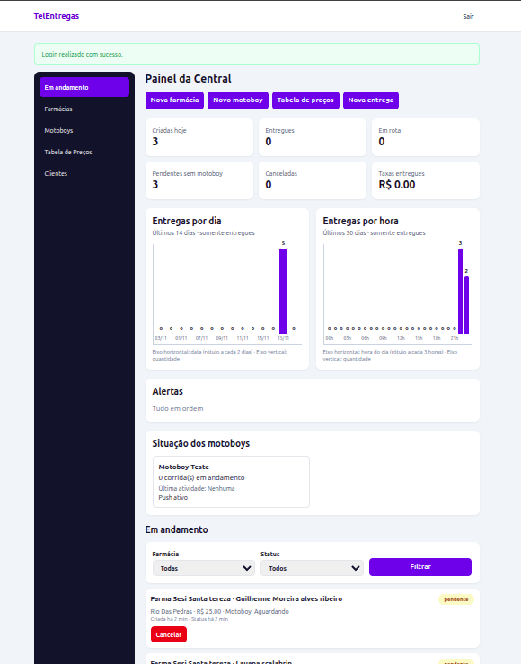
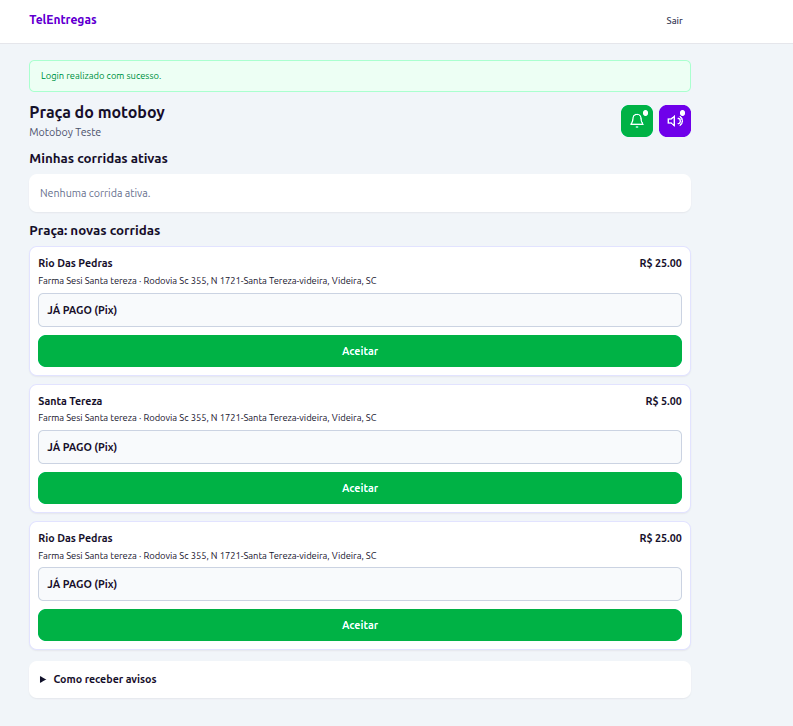
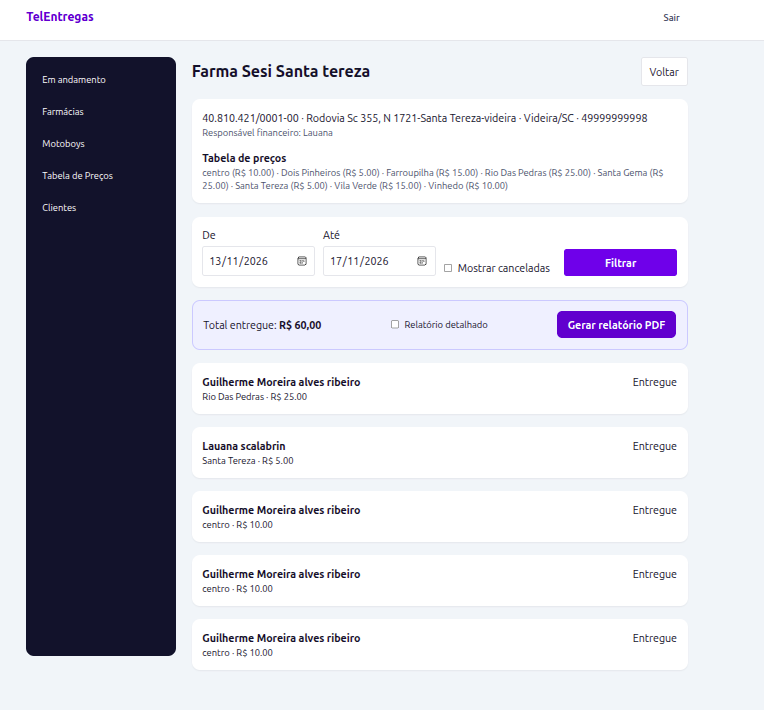

# TelEntregas

Sistema web de gestão de entregas para motoboys, pensado para farmácias. A farmácia registra o pedido, os motoboys recebem um aviso no celular (mesmo com a tela bloqueada), o primeiro que aceitar assume a corrida, e a Central acompanha tudo e gera o relatório de fechamento em PDF para cobrar cada farmácia.


> Projeto desenvolvido como um sistema real de ponta a ponta: modelagem, regras de negócio, notificações push, relatórios, privacidade de dados e publicação em nuvem.

## Demonstração

<!-- Adicione aqui as capturas de tela (use SEMPRE dados fictícios) -->
| Painel da Central | Tela do motoboy | Relatório em PDF |
|---|---|---|
|  |  |  |

Vídeo de demonstração: [adicione o link aqui]

> A versão publicada pode estar offline: ela roda em plano gratuito, que "dorme" após alguns minutos sem uso.

## Perfis de acesso

| Perfil | O que faz |
|---|---|
| **Central (admin)** | Cadastra farmácias e motoboys, define a tabela de preços por bairro, cria, cancela e devolve entregas, acompanha o painel e emite relatórios |
| **Farmácia** | Cadastra entregas, acompanha as corridas em andamento e consulta o histórico e os próprios clientes |
| **Motoboy** | Recebe aviso de nova entrega, aceita, coleta, entrega e abre a navegação no app de mapas |

## Funcionalidades

**Entregas**
- Ciclo de status: pendente → aceita → coletada → entregue (ou cancelada)
- **Aceite atômico:** se dois motoboys aceitam ao mesmo tempo, só um assume e o outro recebe uma mensagem
- Coleta em lote, quando o motoboy retira vários pedidos na mesma farmácia
- Cancelamento (somente pela Central, com motivo) e devolução da corrida à praça, sem apagar o histórico
- Formas de pagamento para orientar o motoboy: Pix, dinheiro (com troco), cartão, convênio e já pago

**Notificações e mobile**
- PWA instalável, com Service Worker
- Web Push com chaves VAPID, funcionando com a tela bloqueada (Android e iPhone com iOS 16.4+)
- Interface mobile-first para o motoboy

**Mapas**
- Links para Google Maps, Waze e Apple Maps, sem API paga
- "Ir até a farmácia" (corrida aceita) e "Navegar até o cliente" (corrida coletada), com rota de várias paradas
- Posição das farmácias geocodificada e ajustável no mapa (Leaflet + OpenStreetMap)

**Gestão**
- Tabela de preços por bairro, separada para cada farmácia; a taxa é copiada para a entrega no momento da criação, então mudar o preço não altera o histórico
- Cadastro de clientes por farmácia, com CPF validado e preenchimento automático do último endereço
- Painel da Central com indicadores do dia, alertas de atraso, situação dos motoboys e gráficos
- Relatório de fechamento em PDF por período, somando apenas entregas concluídas (canceladas ficam em seção separada, fora do total)

## Tecnologias

- **Backend:** Python, Flask, SQLAlchemy, Flask-Migrate (Alembic), Flask-Login, Flask-WTF (CSRF), Flask-Limiter
- **Banco de dados:** PostgreSQL
- **Frontend:** Jinja2, Tailwind CSS, JavaScript
- **Notificações:** pywebpush (Web Push / VAPID)
- **PDF:** WeasyPrint
- **Mapas:** Leaflet, OpenStreetMap, dados de municípios do IBGE
- **Produção:** Docker, Gunicorn, hospedagem no Render

## Decisões técnicas

- **Concorrência:** o aceite usa `UPDATE ... WHERE status = 'pendente'` e confere o número de linhas afetadas, o que evita duas pessoas assumirem a mesma corrida.
- **Valores monetários** em `Numeric(10,2)` e cálculos com `Decimal`, nunca `float`.
- **Histórico imutável:** a entrega guarda uma cópia da taxa, do nome e do endereço do cliente. Editar o cadastro depois não reescreve o passado.
- **Cancelar não apaga:** o registro permanece, com status e motivo, e fica fora dos totais.
- **Polling resiliente:** as telas atualizam a cada 10 segundos, com delegação de eventos para não perder botões e modais a cada redesenho, e as APIs respondem JSON 401/403 em vez de redirecionar.
- **Sem API paga de mapas:** a navegação usa links universais, e a geocodificação é feita uma vez, no cadastro.

## Segurança e privacidade (LGPD)

- Senhas com hash, CSRF em todos os formulários e ações, controle de acesso por perfil
- Cada farmácia só acessa os próprios dados e clientes
- CPF armazenado só com dígitos, exibido mascarado e **nunca** enviado ao motoboy, ao PDF, às notificações ou aos logs
- Limite de tentativas de login por IP
- Cookies de sessão `Secure`, `HttpOnly` e `SameSite` em produção
- Usuários podem ser desativados sem apagar o histórico

## Como rodar localmente

Pré-requisitos: Python 3.12, PostgreSQL e (para gerar PDF) as bibliotecas do WeasyPrint (`libpango`, `libpangoft2`, `libharfbuzz`).

```bash
git clone https://github.com/guilhermema/Telentregas.git
cd Telentregas

python3 -m venv .venv
source .venv/bin/activate
pip install -r requirements.txt

cp .env.example .env
# edite o .env com seus valores (veja a tabela abaixo)
```

Crie o banco no PostgreSQL:

```sql
CREATE USER telentregas_user WITH PASSWORD 'sua-senha';
CREATE DATABASE telentregas OWNER telentregas_user;
```

Gere as chaves de notificação e aplique as migrações:

```bash
python gerar_vapid.py        # cole as chaves geradas no .env
flask --app app:create_app db upgrade
python seed.py               # cria o usuário admin (ADMIN_USERNAME / ADMIN_PASSWORD)
```

Opcional, **somente para desenvolvimento**: `python seed_teste.py` cria uma farmácia e motoboys de exemplo.

Inicie o servidor:

```bash
flask --app app:create_app run --debug
```

Acesse `http://127.0.0.1:5000`. Para testar o Web Push no celular é preciso HTTPS (por exemplo, com um túnel do Cloudflare).

### Testes

```bash
python test_relatorio.py
python test_clientes.py
```

## Variáveis de ambiente

| Variável | Descrição |
|---|---|
| `SECRET_KEY` | Chave secreta da aplicação (`python -c "import secrets; print(secrets.token_hex(32))"`) |
| `DATABASE_URL` | Conexão com o PostgreSQL |
| `CENTRAL_WHATSAPP` | WhatsApp da Central, com DDI e DDD, só números |
| `VAPID_PUBLIC_KEY` / `VAPID_PRIVATE_KEY` | Chaves do Web Push, geradas por `gerar_vapid.py` |
| `VAPID_CLAIM_EMAIL` | E-mail de contato, no formato `mailto:voce@exemplo.com` |
| `ADMIN_USERNAME` / `ADMIN_PASSWORD` | Login do primeiro administrador (usado pelo `seed.py`) |
| `FLASK_ENV` | Use `production` no servidor |

Nunca versione o arquivo `.env`.

## Publicação (Render)

O projeto inclui um `Dockerfile` que instala as dependências do WeasyPrint, aplica as migrações e inicia o Gunicorn.

1. Crie um banco PostgreSQL no Render e copie a **Internal Database URL**.
2. Crie um **Web Service** a partir do repositório, escolhendo o ambiente **Docker**, na mesma região do banco.
3. Cadastre as variáveis de ambiente da tabela acima.
4. Faça o deploy. Cada `git push` na branch `main` publica uma nova versão.
5. Para o iPhone receber notificações, abra o endereço no Safari e use **Compartilhar → Adicionar à Tela de Início**.

## Estrutura (resumo)

```
app/
  blueprints/     rotas por perfil (auth, central, farmacia, motoboy, api)
  templates/      páginas Jinja2
  static/         CSS, ícones, manifest e service worker
  utils/          validadores (CPF, telefone) e funções auxiliares
  models.py       modelos SQLAlchemy
  push.py         envio de Web Push
  report.py       relatório de fechamento em PDF
migrations/       migrações do banco (Alembic)
config.py         configuração por variáveis de ambiente
Dockerfile        imagem para produção
```

## Roadmap

- [ ] Identidade visual e CSS compilado (Tailwind CLI)
- [ ] Campo de município com busca
- [ ] Testes automatizados das regras críticas (aceite, cancelamento e totais)
- [ ] Recuperação de senha
- [ ] Prova de entrega (quem recebeu)
- [ ] Métricas de tempo de aceite e de entrega

## Autor

Desenvolvido por **Guilherme** ([@guilhermema](https://github.com/guilhermema)).
https://www.linkedin.com/in/guilhermeribeirodev02/

## Licença

[Defina a licença antes de publicar. Veja as opções no passo a passo.]
